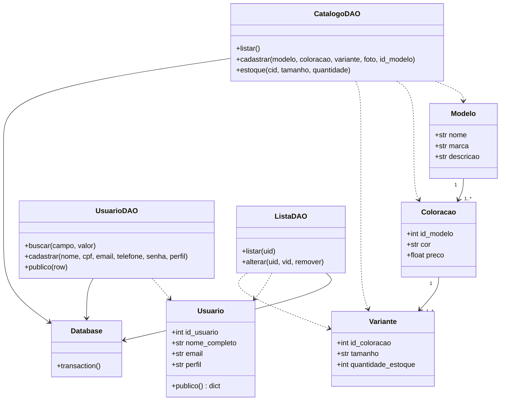

# Diagrama de classes

Versão pronta para leitura e impressão: [UML.pdf](UML.pdf).

O UML complementa os modelos de banco já existentes. Arquivo Markdown com Mermaid, visualizável no GitHub e em extensões Mermaid do VS Code.

Fotos e lista são persistidas pelos DAOs; não têm entidades Python próprias. A API orquestra validações e autenticação em `create_app`. Os relacionamentos de domínio acima são mantidos por IDs e transações, não por coleções de objetos nas dataclasses.
